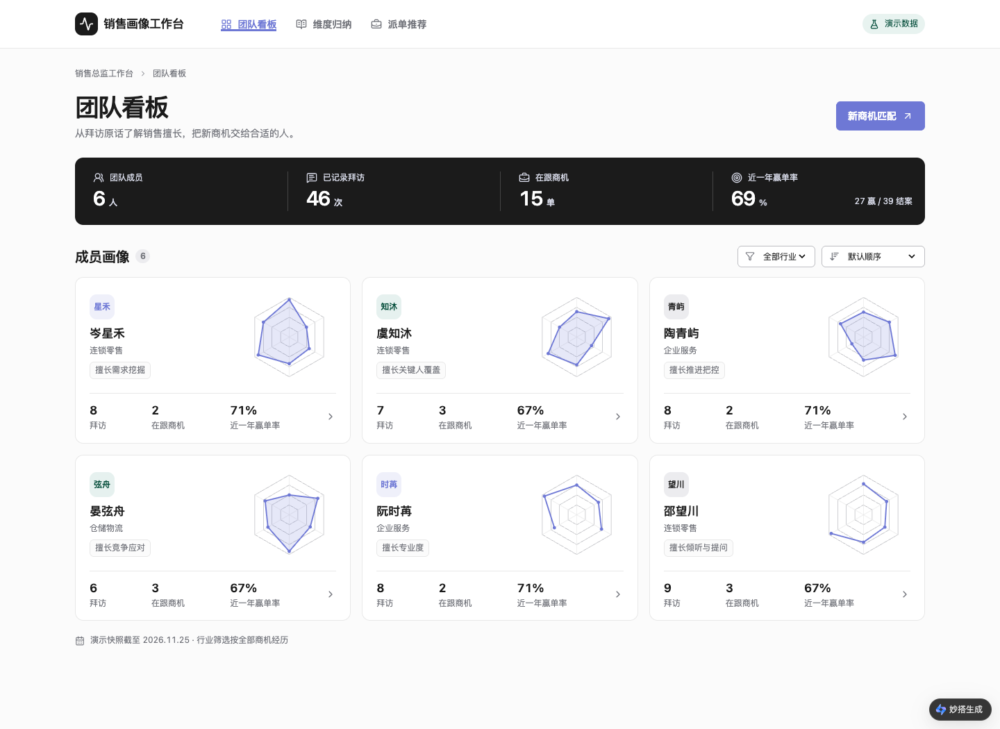
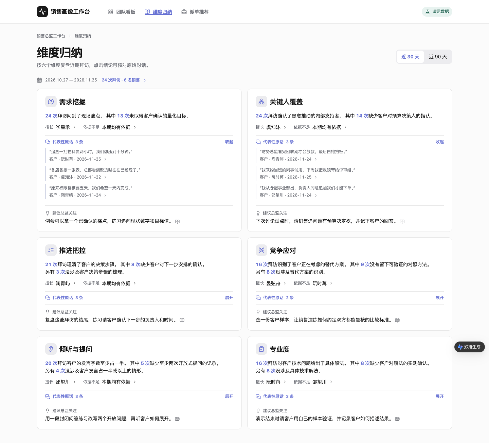

# 销售画像工作台

给销售总监用的飞书妙搭应用，有三个页面：

- **团队看板**：每位销售的六维画像，分别是需求挖掘、关键人覆盖、推进把控、竞争应对、倾听与提问、专业度。
- **维度归纳**：按六个维度归纳团队近 30 天或近 90 天的拜访，说明普遍做得好的地方、普遍缺的那一步，并附代表性原话和建议总监关注的点。
- **派单推荐**：输入新商机，按行业、金额、规模、阶段、竞争对手和关键需求推荐最合适的三位销售。

每个分数、每条归纳都能点回对应拜访的原话。

| 团队看板 | 维度归纳 |
| --- | --- |
|  |  |

## 数据存在哪

- 数据存在妙搭应用自带的 PostgreSQL 里，共三张表：`persona_sellers`（销售）、`persona_deals`（商机）、`persona_visits`（拜访：双方逐字发言 + MEDDPICC 八项）。表结构见 [database/schema.sql](./database/schema.sql)。
- **现在是虚构的演示数据**：6 名销售、60 个商机、46 次拜访，由 [database/demo.py](./database/demo.py) 生成，人名和公司名都是编的。
- **还没有接销售易，也没有接妙记。** 工作台不读也不写销售易。所有分数都按 [shared/observations.ts](./shared/observations.ts) 的规则从逐字稿算出来，不是手填的。

## 和 visit2crm 的关系

visit2crm 负责把录音豆拜访整理好、经销售确认后写进销售易。工作台用的是同一批拜访：逐字稿加 MEDDPICC 提取结果。以后接真实数据时，把确认过的拜访转成 [shared/persona.ts](./shared/persona.ts) 里的数据结构写进上面三张表，画像、归纳和派单的计算都不用改。

后端接口（需登录）：

| 接口 | 返回 |
| --- | --- |
| `GET /api/persona` | 销售、商机、拜访的完整快照，前端按它画画像和派单 |
| `GET /api/persona/dimension-summary?days=30` | 维度归纳。`days` 只接受 30 或 90；每个结论都带对应的 `visitIds`，类型见 [shared/dimension-summary.ts](./shared/dimension-summary.ts) |

## 目录

| 路径 | 内容 |
| --- | --- |
| `server/modules/persona/` | 接口和维度归纳的计算 |
| `shared/` | 六维评分规则、数据结构、接口类型（前后端共用） |
| `client/src/persona/` | 三个页面 |
| `database/` | 表结构和演示数据生成器 |
| `tests/` | 维度归纳的规则测试 |

## 部署和同步

- 工作台部署在飞书妙搭，源码以妙搭自己的 Git 仓库为准。这个目录只是镜像，方便其他项目查看和引用。
- 镜像去掉了妙搭平台文件（`.agents/`、`.spark/` 等）和应用标识，**不能直接从这里部署**。
- 改代码要在妙搭仓库里改。发布后在仓库根目录运行下面的命令，把新代码同步过来：

  ```bash
  scripts/sync-workbench.sh <妙搭仓库的本地路径>
  ```

  这个脚本会顺带检查有没有把应用标识或租户地址带进来。

评分、归纳和派单的完整规则，以及每一轮的验收记录，见 [REPORT.md](./REPORT.md)。
