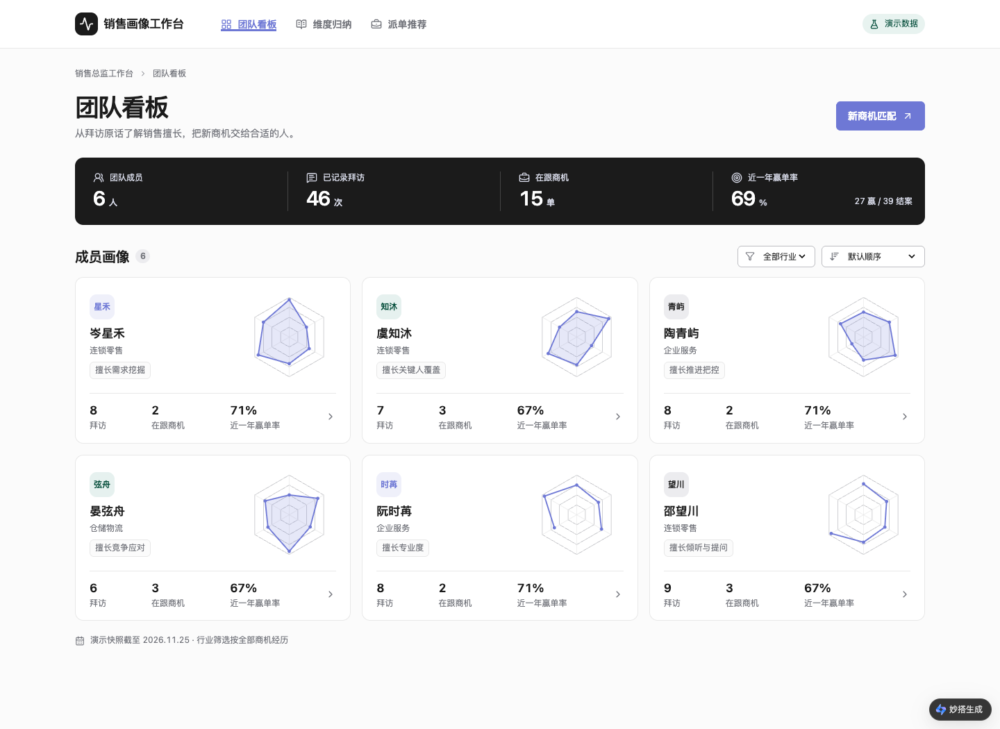
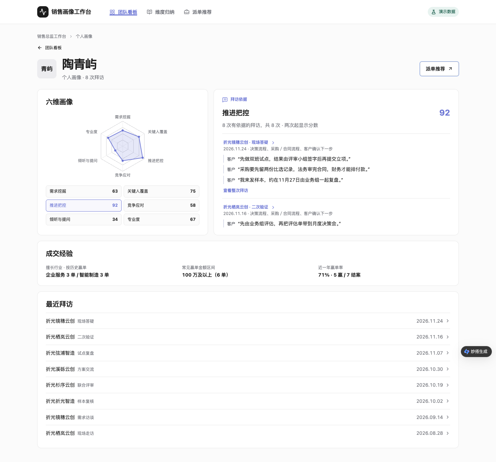
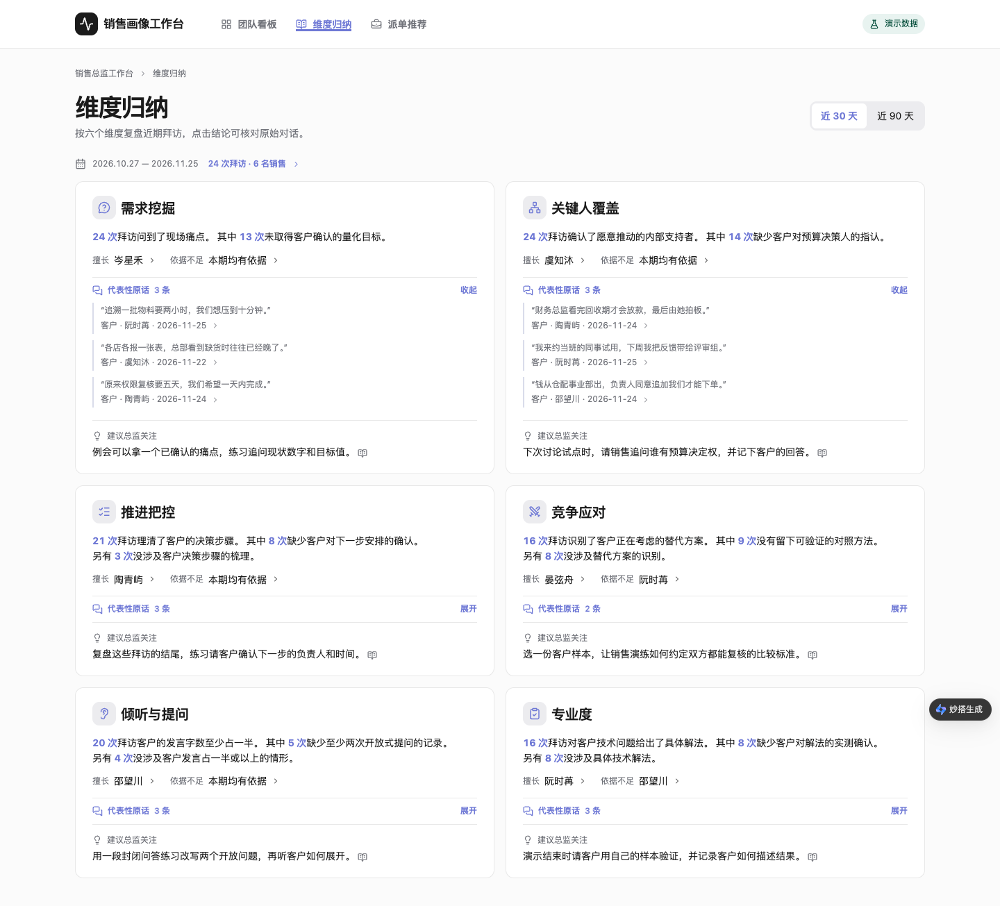
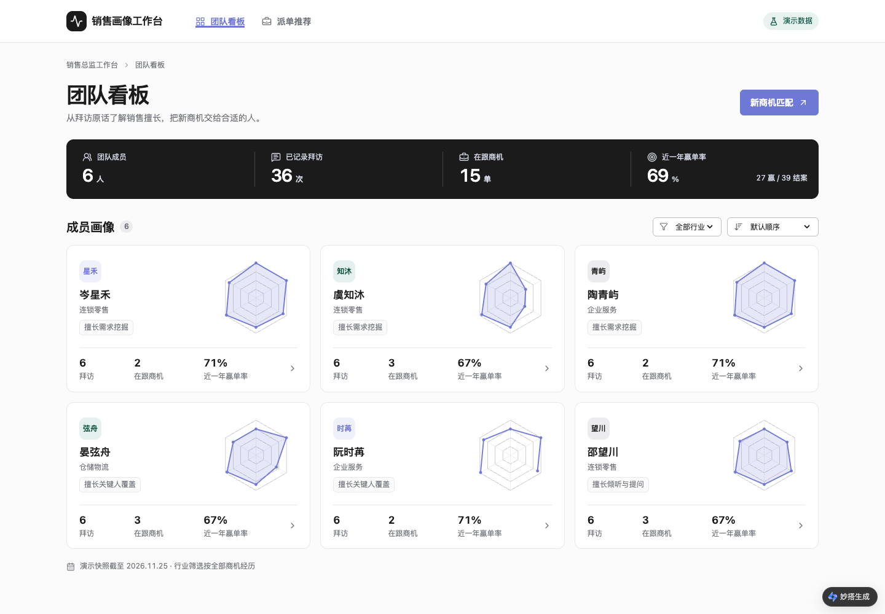
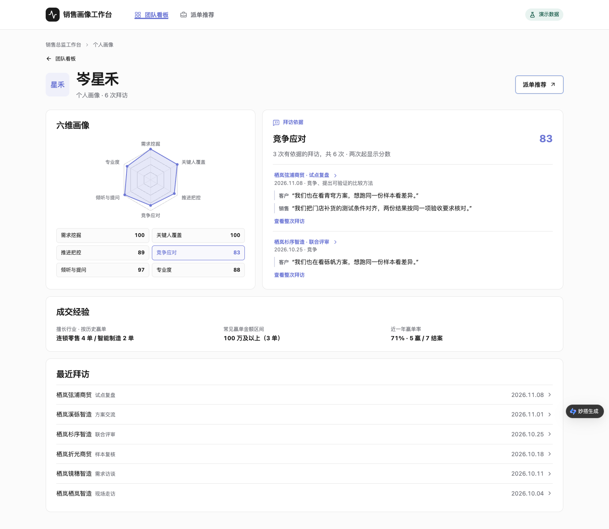
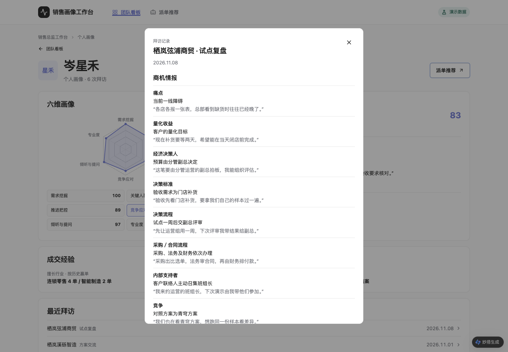
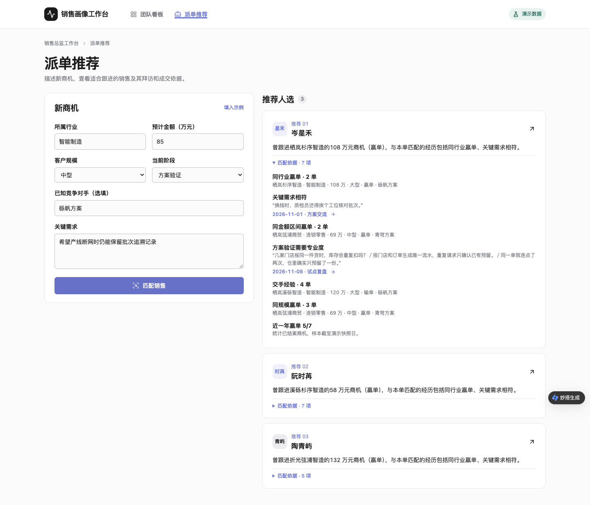

# 销售画像工作台交付报告

## 第三轮：接真实拜访

### 发布与连接

已发布，线上提交为 `49b6e67`。发布理由为「为本人发布已确认拜访的 MCP 同步工具及真实与演示数据切换」。开通 MCP 后再次核对，可见范围为当前登录用户本人 1 人、部门 0 个、群组 0 个，访问需要登录。

**MCP 连接地址**：在本机 `config/app.json` 的 `workbench.mcp_url`（租户地址，不进公开仓库）。以后也可以用 `lark-cli apps +mcp-get --app-id <应用ID> --as user` 取（稳定版 lark-cli 还没有这条命令，见下文）。

**Claude Code**

```sh
claude mcp add --transport http sales-persona <连接地址>
claude mcp login sales-persona
```

**Codex**

```sh
codex mcp add sales-persona --url "<连接地址>"
codex mcp login sales-persona
```

本机与公开稳定版 CLI 均未收录 `+mcp-get`。本轮在临时目录用上游已公开的命令实现构建了独立 CLI，以用户身份调用。发布后的首次 `+mcp-get` 返回 `40906 app MCP is not enabled`，调用 `+mcp-key-create` 准备凭证后，`+mcp-get` 成功返回以上地址。平台下发的连接配置只有 URL，实际地址与脱敏显示一致。客户端首次连接需要由本人完成飞书授权，本轮验收到平台回读与开发态工具实调。[上游 CLI 命令实现](https://github.com/larksuite/cli/pull/2736)

**飞书工作伙伴接入本应用 MCP**　未确认。项目的 `mcp-guide` 提供了 Claude Code 和 Codex 的注册及登录命令，未给出飞书工作伙伴的具体接入步骤。[项目接入指南](https://github.com/larksuite/cli)

### 调用方如何同步

1. 调用 `persona_ingested`，按 `nextCursor` 翻完全部页，保存拜访的编号和更新时间，以及仍在跟的商机编号。
2. 用 `persona_ingest` 提交销售确认过的完整记录。同一批按销售、商机、拜访的顺序处理，因此可以把新拜访及其依赖放在一起。允许单独更新商机输赢。
3. 逐条检查返回。内容相同的记录可直接跳过。校验失败的记录要按字段路径修正。一次请求中已成功的条目可安全重放。

| 工具 | 入参 | 返回 |
| --- | --- | --- |
| `persona_ingest` | 可选数组 `sellers`、`deals`、`visits`，每项带调用方提供的稳定字符串 `id` | `written[]` 是新增或内容有变化的条目，`skipped[]` 是内容相同或被拒绝的条目。每项含 `collection`、从零开始的数组下标 `index`、`id`、`reason`。缺少可读编号时 `id` 为 null。 |
| `persona_ingested` | 首页可传 `{}`。`limit` 为每页两类记录的合计条数，默认 20，范围 1–100。后续传上页的 `cursor = nextCursor`。 | `visits[{id, updatedAt}]`、`openDealIds[]`、`nextCursor`。时间为 UTC ISO 8601。任一数组都可能为空，以游标为 null 判断结束。 |

**记录契约**

- 销售传 `id / name`，编号取销售易用户 ID。
- 商机传 `id / sellerId / company / stage / outcome`，编号取销售易商机 ID。结果为「在跟」「赢单」「输单」。`industry / amount / size / competitor / closed` 可省略或传 null。金额单位为万元，允许正小数，结案日期用 `YYYY-MM-DD`。更新采用整条覆盖，刷新输赢时应一并传回已知字段。
- 拜访传 `id / dealId / title / date / turns / fields`，编号取台账记录 ID，日期用 `YYYY-MM-DD`。`turns[]` 逐句传 `role / text` 及可选 `signal`。每个 `fields` 对象必须含 `pain / metrics / economic_buyer / decision_criteria / decision_process / paper_process / champion / competition` 八个键，每项均有布尔值 `known` 和字符串 `summary / quote`。未知项可传空字符串。[共享类型](./shared/persona.ts) · [下游使用说明](./server/mcp/skills/persona-sync/SKILL.md)

**逐条校验**

说话人仅限客户和销售。已知项需要非空摘要，且引文必须在同一句客户发言中逐字出现。销售自己的复述无法充当引文。商机须引用真实销售，拜访须引用真实商机。相同编号可分别存在于真实与演示来源，数据库的主键和外键都包含来源。

| 标注 | 可接受的位置 |
| --- | --- |
| `next` | 客户确认下一步的发言 |
| `comparison` | 紧跟竞争项客户引文的销售发言。若引文重复出现，沿用评分函数首次定位的位置。 |
| `technical_question` | 一次拜访标记一处用于取证的客户技术提问。其余原话可保留在逐字稿中。 |
| `technical_answer` | 紧跟该客户提问的销售解法 |
| `validated` | 紧跟该销售解法的客户验证 |

例如，第二条拜访的痛点引文对不上时，返回中对应条目的 `collection` 为 `visits`，`index` 为 1，原因包含 `fields.pain.quote`。相同内容重传保持拜访更新时间。修改拜访标题或内容后，原编号的更新时间会推进。

### 页面与统计日

首次打开时，只要存在真实拜访，页面就默认显示真实数据，统计日取北京时间当天。右上角可切换「真实数据 / 演示数据」。没有真实拜访时只显示演示标记，统计日沿用 2026-11-25。演示销售、商机和拜访不会进入真实画像。真实商机缺少行业、金额、规模、竞争对手时，详情显示「未填」，缺失项不参与派单匹配。

`GET /api/persona` 与 `GET /api/persona/dimension-summary?days=30` 共用可选参数 `source=real|demo`；省略时使用默认来源。两者都返回 `source / hasRealVisits / asOf`。维度归纳仍支持 30 天和 90 天。评分、归纳及派单权重沿用第二轮。

### 验收

开发态通过 MCP 协议调了两个工具。一批虚构数据中，销售、商机、一条合格拜访写入成功，另一条因客户引文失配被跳过。回读、分页、相同内容重写、修订拜访、刷新商机输赢、缺少销售或商机的失败分支均已验证。无登录身份的直接调用收到 `MCP_USER_REQUIRED`。浏览器验证了默认来源、来源切换、拜访详情的四项空值、两种来源的维度归纳，以及仅凭客户需求命中的派单。开发库仅按本次虚构编号清理，清理后回读为空，页面恢复为 6 张演示销售卡。自动测试通过 6 项，前后端类型检查、ESLint 和 Stylelint 已通过。

生产构建通过，已核对产物包含工具和同步说明。线上三张表均只有演示行，共 6 名销售、60 个商机、46 次拜访。去掉新增的来源列后，按主键排序计算的三张表全行摘要分别与发布前相等。三张表的真实来源写入策略均已回读，开发到线上待迁移项为零。

---

## 第二轮改动

本次修订已发布（妙搭仓库提交 `cf8c7ac`），六维缺口和关注建议只计已涉及前提但缺少后续记录的拜访，未涉及的另列，同时过滤高度相似的代表性原话，并为关键人覆盖补充了不同的演示说法。

### 新的演示画像

本轮重写拜访对话与 MEDDPICC 提取结果，沿用第一轮六维评分公式。6 名销售共有 46 次拜访，分布在 2026 年 8 月 28 日至 11 月 25 日。60 个商机的成交历史保持原口径。下表为完整 90 天的实际回算结果。

| 销售 | 拜访 | 需求挖掘 | 关键人覆盖 | 推进把控 | 竞争应对 | 倾听与提问 | 专业度 | 对话中可看到的差异 |
| --- | ---: | ---: | ---: | ---: | ---: | ---: | ---: | --- |
| 岑星禾 | 8 | 94 | 50 | 58 | 67 | 90 | 75 | 常问到可量化的目标。内部联络人愿意推动，但预算决定者仍待确认。 |
| 虞知沐 | 7 | 64 | 93 | 43 | 70 | 83 | 50 | 能区分预算决定者与内部支持者。对话有评审步骤，较少约定具体下一步。 |
| 陶青屿 | 8 | 63 | 75 | 92 | 58 | 34 | 67 | 会确认评审、签约和复盘安排。多用封闭式问题，由销售讲解计划。 |
| 晏弦舟 | 6 | 50 | 83 | 61 | 92 | 62 | 70 | 常提出用同一组样本比较竞品。问到了现场痛点，缺少量化目标。 |
| 阮时苒 | 8 | 75 | 63 | 72 | 数据不足 | 65 | 94 | 能给出技术解法并请客户实测。关键人覆盖相对薄弱，竞争方案只有一次记录。 |
| 邵望川 | 9 | 78 | 67 | 62 | 69 | 94 | 数据不足 | 常用开放问题引出客户描述。采购步骤与下一步安排较少同时出现，技术问答仅有一次记录。 |

日期和对话场景由[演示数据生成器](./database/demo.py)定义。所有分值和空值均由[共享观察规则](./shared/observations.ts)计算。按条目计分的双项维度中，一次有证据的拜访只命中一项时即得 50 分；推进和倾听维度允许更低的观测值。开发库重复导入本轮数据，三张表的变更数均为零。

预填派单示例仍为智能制造、85 万元、中型客户、方案验证、砾帆方案和批次追溯。推荐依次为**阮时苒、岑星禾、陶青屿**。三人均有同行业历史赢单。阮时苒在方案验证所需的专业度上为 94，且有同金额区间和规模的赢单；岑星禾有相同区间及规模经验，专业度为 75；陶青屿可提供同行业和竞品交手经验，本例没有命中相同赢单金额区间或规模。推荐卡展示具体商机，并可跳到该销售最擅长维度的依据。

### 维度归纳如何计算

默认近 30 天，也可选择近 90 天。两档都以页面所示演示快照日 2026 年 11 月 25 日为终点，起点为终点减去「天数减一」，首尾日都计入。对应 10 月 27 日至 11 月 25 日的 24 次拜访，以及 8 月 28 日至 11 月 25 日的 46 次拜访。两档窗口均按独立拜访计数。

| 维度 | 前提 | 涉及前提（30 天 / 90 天） | 其中缺少的后续记录 | 缺口（30 天 / 90 天） | 另有未涉及（30 天 / 90 天） |
| --- | --- | ---: | --- | ---: | ---: |
| 需求挖掘 | 销售提问后取得客户痛点引文 | 24 / 46 | 缺少销售提问后客户确认的量化目标 | 13 / 26 | 0 / 0 |
| 关键人覆盖 | 客户指认内部支持者 | 24 / 45 | 缺少经济决策人的客户引文 | 14 / 26 | 0 / 1 |
| 推进把控 | 获得客户确认的决策步骤 | 21 / 39 | 缺少客户确认的下一步安排 | 8 / 18 | 3 / 7 |
| 竞争应对 | 客户说出替代方案 | 16 / 32 | 缺少销售紧随其后提出的可验证对照方法 | 9 / 19 | 8 / 14 |
| 倾听与提问 | 双方均有发言，客户有效字符占比至少一半 | 20 / 37 | 缺少双方有效对话中至少两次开放式提问的记录 | 5 / 13 | 4 / 9 |
| 专业度 | 客户具体提问后销售给出解法 | 16 / 31 | 缺少紧随解法的客户实测确认 | 8 / 17 | 8 / 15 |

- **归纳与关注点。** 缺口只计已涉及前提且缺少后续证据的拜访，建议链接指向这批拜访。其余未涉及前提的拜访单列，数量为零时省略该句。
- **成员。** 只用窗口内的有效观察重算个人分项。达到 75 且居本期最高值者标为「擅长」，并列一并展示。少于两次有效观察标为「依据不足」。点击成员会列出该窗口审阅过的拜访，并逐条标明哪些有该维度依据。两档窗口中，阮时苒的竞争应对、邵望川的专业度都属依据不足。
- **原话。** 从该维有效观察关联的逐字发言选取，优先覆盖有后续动作和只有部分记录的不同场景，优先来自不同销售。同次拜访只选一句，将引文规范化，用相邻字符对的 Dice 相似度去重（达到 0.70 视作近似），最多三条。每条保存拜访编号、说话人、原文和发言序号，点击后高亮该句。两个窗口中，竞争应对各选出两条，其余维度各三条。
- **接入真实妙记。** 登录后调用 `GET /api/persona/dimension-summary?days=30` 或 `days=90`。省略参数默认 30，其他值返回 HTTP 400。后端按日期查询妙搭库，使用与雷达相同的逐字稿核验和计分规则按成员、维度汇总。接入时需把演示快照日改为真实统计日，并提供带说话人、稳定编号和可复核标注的拜访记录。

接口返回 `days / from / asOf`、窗口拜访 `visits[]` 和六项 `dimensions[]`。每次拜访附销售、公司、逐字稿及八项情报；每维含 `strengths / gaps / unaddressed / advice` 的文字和对应 `visitIds`，`people` 的分项、有效编号和已审阅编号，`strongest` 的成员编号，以及 `quotes` 的 `visitId / turnIndex / role / text`。姓名、数字、引用与建议可沿同一份接口响应复核。[类型定义](./shared/dimension-summary.ts) · [后端归纳实现](./server/modules/persona/dimension-summary.ts)

### 本轮截图与验收

截图来自连接妙搭开发库的本地运行页面。个人页示例为陶青屿，归纳页使用默认近 30 天。

| 团队看板 | 陶青屿的个人画像 |
| --- | --- |
| [](./screenshots/r2-team.png) | [](./screenshots/r2-person.png) |

[](./screenshots/r2-dimensions.png)

线上按完整业务字段回读并与开发库逐项对照，6 名销售、60 个商机、46 次拜访全部一致。368 项 MEDDPICC 中，254 项已知情报逐字命中对应客户发言，114 项未知的摘要和引文均为空。按线上数据复算两档窗口，共 34 条次代表性引文均可按说话人和发言序号定位到逐字原文。访问范围读回为登录用户本人 1 人、部门 0 个、群组 0 个。

已通过前后端类型检查、ESLint、Stylelint 和生产构建。在浏览器中切换近 30 天和近 90 天，逐项比对六维统计与建议链接打开的拜访列表，并点开全部代表性原话核对高亮发言。此前已验证成员依据、派单示例、手机宽度，以及首尾日、未来日期、空窗口和个人分项的一致性。

---

以下为第一轮交付记录，保留当时的数据和截图供对照。

## 直接执行

总监可以从团队看板选择销售，查看六维画像，再沿分数回到当次拜访的客户原话。派单页接受行业、金额、客户规模、当前阶段、已知竞争对手和关键需求，给出最多三位人选、一句话理由及对应的历史商机或拜访。

### 应用与发布

- 妙搭全栈应用（`full_stack`），开发分支为 `sprint/default`，每次发布自动合入 `main`。本目录由 `scripts/sync-workbench.sh` 从妙搭仓库的 `main` 同步。
- 首次发布的提交为 `78e6995`，平台终态为 `finished`。本次发布理由为「发布销售画像工作台的团队看板、个人画像与派单推荐，供创建者使用虚构数据验证派单流程」。
- 已用身份转换核对当前登录用户，再设置并回读运行时范围。登录为必需，指定用户恰好 1 人且与当前用户一致，部门 0 个、群组 0 个。平台返回的访问申请开关为开启，审批人为本人。其他人申请后须经本人另行批准才会获得访问。
- 发布后将演示数据写入线上库，复查销售、商机、拜访三张表的业务字段摘要，均与开发库一致。线上回读为 6 名销售、60 个商机、36 次拜访、288 项情报，已知引文未命中数为 0。
- 所有妙搭操作均以当前用户身份执行，源码推送目标为妙搭自己的 Git 仓库。参考工程仅用于读取字段和业务口径。

### 三个使用入口

| 入口 | 可以完成的操作 |
| --- | --- |
| 团队看板 | 查看团队与个人的拜访数、在跟商机数、近一年赢单率。按有过商机的行业筛选，按六个维度分别排序，数据不足排在有分数的成员之后。按维度排序后点入卡片，会直接打开该维度的依据。 |
| 个人画像 | 切换六维雷达及六个分项，查看每维有效拜访数、取证内容、日期和客户公司。点击拜访能读到 MEDDPICC 八项与整段对话。成交经验列出赢单行业分布、常见金额区间和赢单率分母。 |
| 派单推荐 | 输入新商机或使用预填示例。每条推荐可以展开匹配依据，查看历史商机或打开原话。修改输入后清除上次结果，重新匹配才显示新人选。试算保留在当前页面，不创建业务记录。 |

### 演示数据与指标口径

采用 2026 年 11 月 25 日的固定演示快照。6 名虚构销售每人有 6 次拜访，共 36 次。60 个虚构商机覆盖智能制造、连锁零售、企业服务、仓储物流，金额单位为人民币万元。在跟 15 单，历史赢单 32 单、输单 13 单。页面角上统一显示「演示数据」。

- 拜访数按独立拜访记录计。在跟商机按当前状态计。近一年结案窗口为 2025 年 11 月 25 日之后至 2026 年 11 月 25 日（含）。期间 39 单结案，赢 27 单，团队赢单率为 69%。个人和团队都先汇总分子、分母再取整。零结案时保留空值。
- 行业经验和金额区间使用截至快照日的全部历史赢单。金额分为小于 50 万、50 万至不足 100 万、100 万及以上。行业与金额按各自赢单数排序，并在个人页给出样本数。各类经验与成交结果单列展示。
- 每次拜访保存双方发言和 MEDDPICC 的八组 `known / summary / quote`。客户逐字引文与销售发言分开核验。开发库共 288 项，已知 234 项，全部在对应客户发言中找到；其余 54 项均为空摘要、空引文。
- [数据库结构](./database/schema.sql)维护销售、商机、拜访之间的关系。[演示数据生成器](./database/demo.py)固定生成同一批记录，使用事务和稳定主键，重复导入会跳过已有主键。应用从妙搭数据库读取，浏览器不携带一套备用演示数据。

### 六维画像规则

每次符合条件的拜访生成一个 0–100 的观察值。每维对有依据的独立拜访等权平均，最后四舍五入。少于两次时显示「数据不足」，已有原话仍可查看。完全没有该项观察的拜访跳过。部分项有证据时，保留未满足子项所占的权重。雷达图对缺失轴留空。

| 维度 | 一次拜访如何取分 |
| --- | --- |
| 需求挖掘 | 痛点、量化收益各 50 分。每项同时要求销售上一轮提出问题、客户引文核验通过。 |
| 关键人覆盖 | 经济决策人、内部支持者各 50 分。每项均需客户明确说明并保留原话。 |
| 推进把控 | 决策流程、采购或合同流程、客户确认下一步各占三分之一。下一步使用结构化标注及其对应的客户发言。 |
| 竞争应对 | 客户明确说出替代方案得 50 分。其后销售紧接着给出可验证的比较方法，再得 50 分。仅销售主动提到某对手没有观察值。 |
| 倾听与提问 | 要求双方均有发言。客户发言字符占比除以 60%，封顶后乘 50；销售开放式提问数除以 4，封顶后乘 50，两者相加。字符数去除空白和标点。开放式提问要求问号以及「什么、哪些、哪一、怎么、如何、谁、多少、哪一步」之一。页面展示占比、计数与整次对话入口。 |
| 专业度 | 客户提出具体技术问题，销售紧接着给出对应解法，得 50 分；紧随其后的客户实测确认再得 50 分。三者均以逐字稿中带说话人的发言为依据。 |

六维均保留。客户确认下一步、竞争回应和技术问答的角色由演示逐字稿标注，再由规则检查顺序与说话人；「专业度」只覆盖这类可观察的问答及客户验证。「倾听」的演示代理量是字符占比，真实录音如有可靠时间戳，可替换成发言时长。[规则实现](./client/src/persona/model.ts)

### 派单推荐规则

各项累计，理论上限 100。历史匹配项命中一次即取得该项权重，更多同类商机只增加解释里的样本数。排序按未取整的总值，同值按稳定销售编号。页面呈现推荐理由与原始依据，不展示团队综合名次。

| 输入或历史结果 | 权重与依据 |
| --- | --- |
| 行业、预计金额、客户规模 | 历史赢单中分别命中同一行业、金额区间、规模时，加 23、16、10。各自显示匹配单数及最近一条命中商机。 |
| 竞争对手 | 与已结案商机的竞争对手名称精确匹配，加 12。多名称取任一，赢单与输单均算交手经验。留空时该项为零。 |
| 当前阶段 | 需求澄清对应需求挖掘、方案验证对应专业度、商务采购对应推进把控。该维有分数时，加「分数 ÷ 100 × 16」，附拜访依据。 |
| 关键需求 | 需求词或同主题词命中一段客户原话，加 17，显示命中的引文和拜访。演示词表覆盖批次追溯、门店补货、权限审计和异常交接，输入中的其他词组也可逐字匹配。 |
| 历史赢单率 | 近一年实际赢单比例乘 6。没有已结案样本时该项为零。 |

### 验证与截图

前后端类型检查、ESLint、Stylelint 和生产构建已通过。规则校验覆盖销售自述冒充客户引文、引文不存在、仅一次拜访、空推荐及近一年窗口边界。浏览器实测覆盖筛选、维度排序、无证据分项、拜访弹窗、改条件重新推荐，以及 390 像素宽度下的布局。截图来自连接妙搭开发库的本地应用。线上验收覆盖妙搭发布终态、正式数据库和运行时可见范围；登录后的线上页面未另行截图。

| 团队看板 | 个人画像 |
| --- | --- |
|  |  |

| 拜访证据 | 派单推荐 |
| --- | --- |
|  |  |

[手机看板截图](./screenshots/05-mobile.png)

## 深度交互

使用预填的「智能制造、85 万、中型、方案验证、砾帆方案、产线批次追溯」样例，依次推荐岑星禾、阮时苒、陶青屿。只调整行业为连锁零售、金额为 26 万、需求为门店补货与库存核对后，第二、第三位换成虞知沐、晏弦舟。可沿每位人选的匹配依据复核差异。

六次拜访足以演示证据回溯，尚不足以校准对人的判断。总监读画像时，应连同有依据的次数、客户角色和拜访阶段解读分数。某人如果只在两次拜访谈到了竞争，竞争维度反映的是这两次对话。

后续接真实妙记时，可把经销售确认的提取结果转成 [拜访数据契约](./shared/persona.ts)中的双方发言、八项情报及带依据的对话标注，再关联稳定的商机与销售编号。成交结果要有独立的结案日期和输赢来源。这样能沿用证据、画像和推荐计算逻辑；当前演示没有接通真实妙记、AI 提取或销售易。

界面采用妙搭 React 脚手架，按真实分数绘制雷达图，支持逐维缺失与点击取证。
